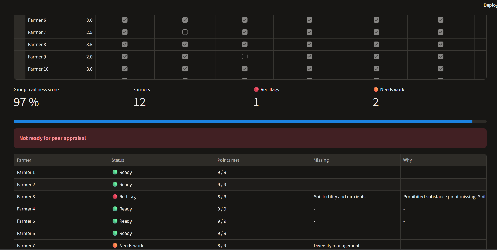

# OrganicPath

Trace organic produce from farm to table.

## Problem
Buyers cannot easily check if produce is really organic.

## Users
Farmers, shop owners and consumers.

## Features
- Store organic product records
- Search by product or farm
- Filter by category

## Tech
Python and JSON

## Author
Vaishnavi

## RAG evaluation (Day 8)

My bot answers only from retrieved chunks of the official PGS-India documents
and cites the source and page. If the chunks do not contain the answer, it
says "I don't know". I tested 2 retrieval settings on 15 questions
(13 answerable, 2 that my documents cannot answer, such as the Pune shop
question).

| Config | Chunk size | Top-k | Retrieval hit | Correct answers | Correct 'I don't know' | Overall |
|--------|-----------|-------|---------------|-----------------|------------------------|---------|
| A | 120 words | 3 | 12/13 | 12/13 | 2/2 | 14/15 |
| B (winner) | 60 words | 5 | 13/13 | 13/13 | 2/2 | 15/15 |


**Winner: config B.** Write 2 sentences in your own words: what B did better
than A (for example smaller chunks and more results), and what the table shows.

Full results: [eval/eval_results.md](eval/eval_results.md)

## OrganicPath app (Day 10)

- **Chat** with the official PGS-India documents. Answers show their sources and page, can be rated 👍/👎 (saved in `data/feedback.jsonl`), and say "I don't know" when the documents do not contain the answer.
- **Peer-appraisal readiness checklist**: the group ticks the standard appraisal points per farmer and sees a group readiness score, with a red flag for any farmer whose default would put the group at risk.

Run it (two terminals):

```
python -m uvicorn app.main:app
python -m streamlit run ui/app.py
```




## Run with Docker

1. Ensure Docker Desktop is running and `.env` is configured.
2. Build and start both services:
   ```bash
   docker compose up --build