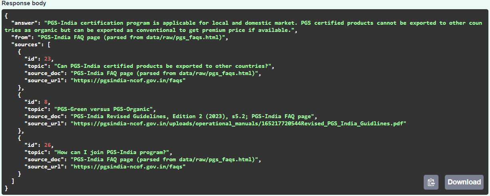

# Checkpoint 1

## FastAPI is running



The service has 5 routes: `GET /health`, `GET /records`, `GET /records/{id}`,
`GET /search` and `POST /questions`.

## One function explained: `SmartSearch.search`

File: `app/smart_search.py`

```python
def search(self, query, top_k=3):
    if self.unknown_ratio(query) >= UNKNOWN_LIMIT:
        return []
    query_vector = self.vectorizer.transform([expand(query)])
    scores = cosine_similarity(query_vector, self.matrix)[0]
    best = scores.argsort()[::-1][:top_k]
    ...
```

What it does, step by step:

1. `unknown_ratio` checks how many words of the question never appear in my
   records. If half or more are unknown, my data cannot answer, so it returns
   an empty list and the API says it could not find the answer.
2. `expand(query)` adds a few related words (for example "farmers" also adds
   "members"), because my records say "members".
3. `transform` turns the question into a list of numbers using TF-IDF. TF-IDF
   gives a higher weight to words that are meaningful and rare, and a lower
   weight to common words.
4. `cosine_similarity` compares that list with every record and gives each
   record a score. A higher score means a closer match.
5. `argsort()[::-1][:top_k]` sorts from highest to lowest and keeps the best 3.

## A bug I found and fixed

My question Q6 ("Which shop in Pune pays the highest price for PGS-certified
jaggery?") is not in my documents, but the bot answered with the export rule.
TF-IDF only matches words, and "PGS", "certified" and "price" appear in that
record. I fixed it with `unknown_ratio`. After the fix Q6 is refused, and Q1
and Q10 are still answered. This is the same problem as an LLM hallucinating:
a system that always returns its best guess will give a confident wrong answer
unless it is allowed to say "I don't know".