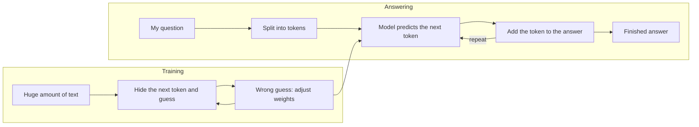

# How LLMs work (in my own words)

A large language model (LLM) is a program that is very good at one job:
**guessing the next piece of text.** Everything else it does, such as answering
questions or writing code, comes from doing that one job many times in a row.

## 1. Tokens

A model does not read letters or whole sentences. It first cuts the text into
small pieces called **tokens**. A token can be a whole word ("farmer"), part of
a word ("certi" + "fication") or a symbol. Each token is then turned into a
number, because the model only works with numbers.

The model can only look at a limited number of tokens at one time. This limit
is called the **context window**. If my prompt plus its answer is longer than
that, the model forgets the beginning.

## 2. Training

Before I ever talk to it, the model is **trained**. It reads a huge amount of
text (books, websites, code) and plays a guessing game: it hides the next
token and tries to predict it. When it guesses wrong, its internal numbers
(called **weights**) are adjusted a little. After billions of rounds the model
becomes good at predicting which word usually comes next.

After this, the model is often trained a second time with human feedback, so
that it follows instructions and answers politely instead of just continuing
the text.

The model learns **patterns in text**. It does not look things up in a
database while it answers, and it only knows what was in its training data up
to a cut-off date.

## 3. How it answers

1. My question is split into tokens.
2. The model gives every possible next token a probability.
3. It picks one token and adds it to the text.
4. It repeats from step 2 until the answer is finished.

## 4. Hallucination

Because the model predicts **likely-sounding** text, it does not check whether
the text is true. If it does not know something, it can still produce a smooth,
confident answer that is wrong. This is called a **hallucination**. It happens
most with exact numbers, names, dates and anything that was not in its
training data.

## Diagram

## Why this matters for OrganicPath

OrganicPath answers rules about PGS-India certification, where one wrong
number can hurt a farmer group. For example, the FAQ page says one member may
hold at most one third of the group's land, and the 2023 Guidelines say 50%. A
model that guesses could pick either number and sound sure.

So OrganicPath does not let the model guess. It first **searches
`data/records.json`** (TF-IDF search), then answers only from the records it
found and shows the source document. If nothing matches, it says it cannot find
the answer. A question like "Which shop in Pune pays the highest price for
PGS-certified jaggery?" is not in my documents, so the correct answer is
"I don't know".